<p align="center">
  
</p>

<h1 align="center">Get Effective Marketing</h1>

<p align="center">
  <b>The website for a local SEO agency in Antwerp, built as a ranking map.</b><br>
  🔴 20+ &nbsp;→&nbsp; 🟠 &nbsp;→&nbsp; 🟡 &nbsp;→&nbsp; 🟢 1
</p>

---

## 📍 The idea

Local SEO agencies run a **geo-grid scan** on every first call: a grid of pins over the city, each one
saying where the business ranks when someone searches from that spot. Red means invisible. Green
means the phone rings.

So the whole site *is* that map. Every number on it is a rank, and every animation is a scan.

| Where | What the map does |
|---|---|
| 🏠 **Home hero** | A real client scan of Budapest. 106 pins go from 20+ to the top 3, radiating out from the business's own pin. |
| 🔘 **Every button** | The little pin ticks **3 → 1** while a green disc floods out from your cursor. |
| 🌀 **Page changes** | A navy scan ring grows from wherever you clicked and carries the next page's name. |
| 🗺️ **Business Profile** | A second real client, Berlin. The grid is read in a wave: rank 1 at all 137 points. |
| 🔎 **Google Ads, Websites** | A simplified results page with *your business* dropping into the layer that service wins. |
| 💶 **Packages** | Each plan is a rank target: page 1, top 3, top 3 plus an ad on top. |
| 🚫 **404** | "This page ranks nowhere." The city, all red, every pin at 20. |

> Every map on the site is a real scan from the agency's own tracker screenshots, transcribed pin
> by pin. No made-up results. (The 404 is a joke, not a client.)

### Pin legend

| Pin | Rank | Mood |
|:---:|:---:|---|
| 🟢 | 1 to 3 | In the map pack. The calls come to you. |
| 🟡 | 4 to 7 | So close. |
| 🟠 | 8 to 14 | Page one, technically. |
| 🔴 | 15 to 20+ | Invisible. Where every client starts. |

---

## 🚀 Run it

```bash
npm install
npm run dev            # http://localhost:3000
```

Production build, the way it should be judged:

```bash
npm run build && npm start
```

## ✏️ Make it yours

Nothing in the markup needs touching to change words, prices or maps.

| You want to change | Edit |
|---|---|
| Any copy, price, FAQ, phone, address | [`src/data/site.ts`](src/data/site.ts) |
| A ranking map (new scan, new city) | [`src/data/maps.ts`](src/data/maps.ts) |
| Colors, type sizes, spacing | the tokens at the top of [`src/app/globals.css`](src/app/globals.css) |
| How fast the home scan plays | `runTo(1, 6.5, …)` in [`src/motion/scan.ts`](src/motion/scan.ts) (seconds) |

### Got a new scan? 🗺️

Each map in `maps.ts` is a 13 × 13 grid typed out row by row. `.` is an empty cell, and a number is the
rank at that point:

```ts
'.  .  3  3  1  1  1  3  1  2  1  1  .',
'.  .  4  2  3  1  1  2  1  1  1  1  1',   // the business sits in this row
```

Then redraw the banner at the top of this README so it shows the new data:

```bash
npm run readme:art
```

## 📬 Contact form

Set one environment variable and the form posts there (Formspree, or any webhook that accepts form data):

```bash
NEXT_PUBLIC_FORM_ENDPOINT=https://formspree.io/f/your-id
```

Without it, the form opens a pre-filled email to info@geteffectivemarketing.com, so no lead is lost.

## 🌍 Deploy

Made for **Vercel**: import this repo, keep the defaults, add `NEXT_PUBLIC_FORM_ENDPOINT`, point the
domain at it. Done.

Every URL matches the current WordPress site (`/google-ads-management/`, `/contact/`, and the rest),
so the Google rankings it already has carry over. Fitting, for an SEO agency.

> Leave `SITE_URL` unset in production. It only exists so local QA can load the share image.

## 🧰 Under the hood

**Next.js 16** (App Router, all pages static) · **GSAP** + **Lenis** on one shared clock · **Archivo**,
one variable font doing three voices (wide display, normal text, condensed map labels) · zero images:
every map is SVG drawn from data.

- One driver ([`src/motion/scan.ts`](src/motion/scan.ts)) sets every pin, ring and readout from the same few
  numbers, so the map and the counters can never disagree.
- Reduced motion gets the finished map, no wave, no smooth scroll.
- Mobile LCP under 0.9 s on a throttled phone, 0 accessibility violations, ~350 KB per page.

The design thinking (concept, palette, type, every decision QA forced) lives in [`DESIGN.md`](DESIGN.md).

## ✅ Before launch

- [ ] 2 or 3 case studies: trade, city, keyword, before and after scans, a real result
- [ ] 3 to 5 Google reviews with a link to the profile
- [ ] Screenshots of websites the agency built, for the WordPress page
- [ ] Confirm whether **Diamond** includes "ranking for your main service term"
- [ ] Decide which phone number Belgian visitors should see
- [ ] Add `NEXT_PUBLIC_FORM_ENDPOINT`

---

<p align="center">
  🟢 <b>This README ranks #1 for "readme that is secretly a ranking map".</b><br>
  <sub>Self-reported. Not verified by Google.</sub>
</p>
